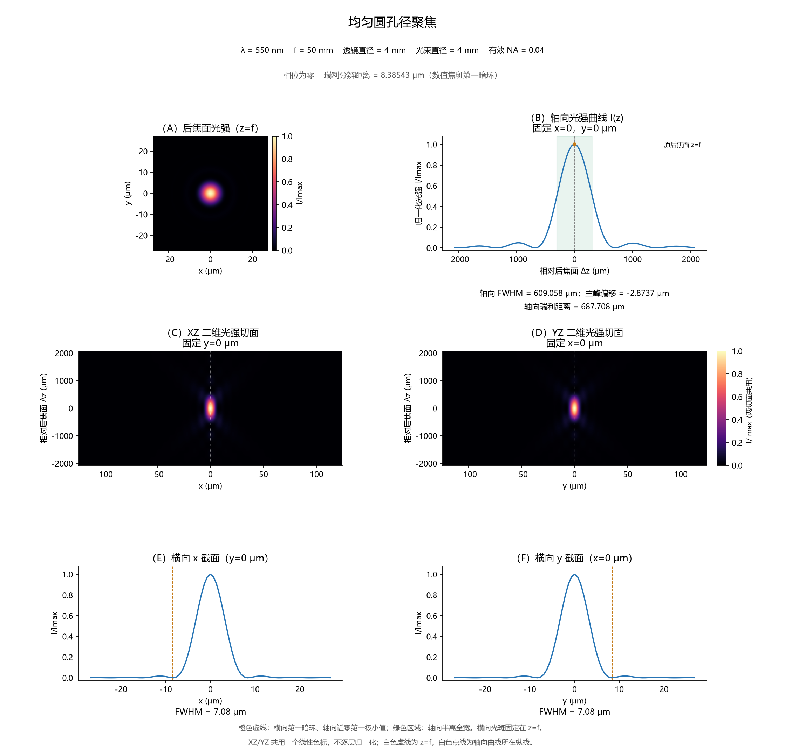
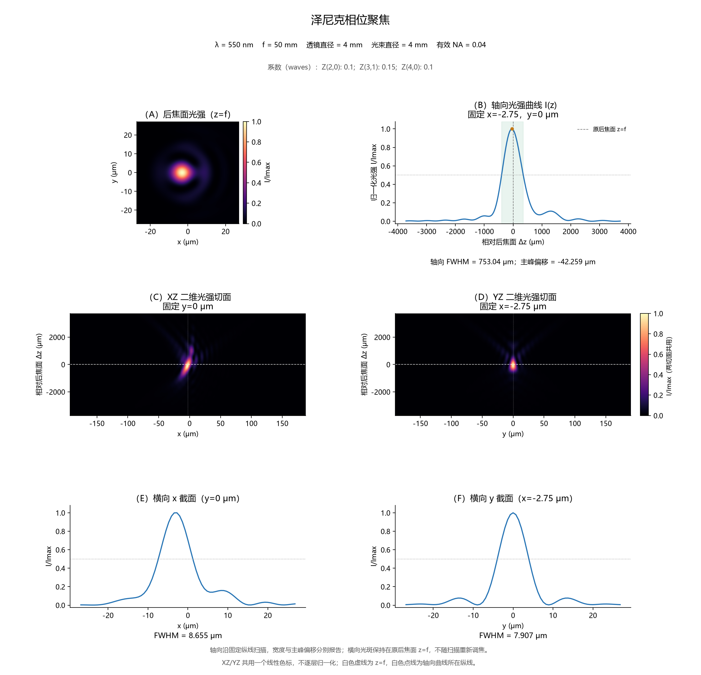

# 均匀光聚焦、分辨率与泽尼克像差

输入波长和有效 NA，或输入波长、透镜直径、焦距和均匀圆光束直径，计算理想分辨尺度，模拟焦面光斑及其轴向变化。

| 程序 | 作用 | 主要输出 |
| --- | --- | --- |
| [resolution.py](resolution.py) | 理论计算，比较可配置的初始介质与样品介质 | 横向、轴向瑞利距离；终端、TXT、JSON，无图 |
| [fourier_focus.py](fourier_focus.py) | 均匀圆光束，零像差 | 后焦面光斑、XZ/YZ、横向与轴向曲线、FWHM、数值瑞利距离 |
| [zernike_focus.py](zernike_focus.py) | 均匀圆光束，加载泽尼克相位 | 同类光场图、横向与轴向 FWHM、轴向主峰偏移 |

三个程序使用相同的标量、近轴、理想薄透镜约定。程序二、三在空气中模拟：后焦面做一次二维 FFT，轴向曲线和 XZ/YZ 切面由物理离焦积分计算，不额外调用二维 FFT。

## 1. 配置与运行

安装 Conda，在项目目录执行以下通用步骤。环境文件由 Conda 根据本机平台解析依赖，无需修改：

```bash
conda env create -f environment.yml
conda activate lpr
```

运行所需程序：

```bash
python resolution.py
python fourier_focus.py
python zernike_focus.py
```

图窗会根据窗口大小自动调整标题、坐标标签和指标标注的间距。轴向 FWHM、瑞利距离与峰值位置分行显示，横向 FWHM 和底部说明各占独立区域。

程序二、三默认显示图窗并保存结果。依次运行时，关闭当前图窗后再运行下一个；只保存文件时使用：

```bash
python fourier_focus.py --no-show
python zernike_focus.py --no-show
```

已有环境可执行 `conda env update -f environment.yml`。也可在已激活的 Python 3.12 虚拟环境中执行 `python -m pip install -r requirements.txt`。常规配置使用 `environment.yml` 或 `requirements.txt`；仓库中的平台锁定文件仅用于复现特定环境。

在 VS Code 中选择 `lpr` 解释器，修改入口顶部的 `PARAMETERS`、`NUMERICS` 后直接运行；F5 提供三个对应配置。图窗缺少桌面显示条件时，使用 `--no-show`。`python 程序名.py --help` 可查看全部命令行参数。

## 2. 参数、单位与光路位置

### 光学参数 `PARAMETERS`

| 参数 | 默认值 | 含义 |
| --- | --- | --- |
| `wavelength_nm` | 550 | 真空波长 λ0，单位 nm；通常标注的空气波长可近似使用 |
| `numerical_aperture` | `None` | 直接指定实际参与聚焦的有效 NA，如 `0.67`；填写后优先使用该值，默认均匀光充分填充，忽略下面三个几何尺寸 |
| `lens_diameter_mm` | 4 | 几何模式：透镜有效圆孔径直径，单位 mm |
| `focal_length_mm` | 50 | 几何模式：工作焦距，单位 mm；程序一指所选初始介质中的焦距，程序二、三仍指空气中焦距 |
| `beam_diameter_mm` | `None` | 几何模式：瞳面上的均匀圆光束直径，单位 mm；`None` 表示自动等于透镜直径 |
| `aberrations` | 见程序三入口 | `ZernikeTerm(n, m, coefficient_waves)` 列表，仅程序三加载 |

程序一使用 `ResolutionConfig`，另外提供两个彼此独立的介质参数；程序二、三仍使用原来的 `OpticalConfig`，只模拟空气，不提供这些介质选项：

| 仅程序一的参数 | 默认值 | 含义 |
| --- | --- | --- |
| `immersion_medium` | `"air"` | 透镜接触的初始介质。支持 `air`→1.0、`water`→1.333、`oil`→1.515，或直接填数值，如 `1.42` |
| `sample_refractive_index` | 1.37 | 焦点所在样品介质的实数折射率，可独立修改，1.37 只是默认示例 |

预设折射率用于演示；准确计算时，应填写实验波长下实际测得或材料给定的折射率。两个折射率均要求为正的有限实数。当前平面界面模型还要求 `n_s > NA_initial`，否则会发生传播角谱丢失，程序明确报错，不继续套用“NA 不变”的公式。

未填写 `numerical_aperture` 时沿用几何模式。例如，只修改透镜直径且保留 `beam_diameter_mm=None` 时，光束直径会跟着变化。需要独立控制欠填充或过填充时，给光束直径填写具体数值。

相位加载面是透镜瞳面的理想共轭面。输入光束直径、相位图案尺寸均指**已经换算到瞳面的等效尺寸**，不再模拟共轭光路。光束与透镜孔径同轴、居中，圆内振幅均匀，加载前波前平坦。

设光束直径为 D_beam、透镜孔径为 D_lens：

```text
D_eff = min(D_beam, D_lens)
程序一：NA_initial ≈ n_i D_eff / (2 f_working)
程序二、三：NA_air ≈ D_eff / (2 f_air)
```

光束较小时，未填满透镜，有效 NA 由光束决定；光束较大时，透镜挡住外围，有效 NA 由孔径决定。在折射率和工作焦距不变时，有效直径减半，理想横向尺度约增大 2 倍、轴向尺度约增大 4 倍。这个 NA 是近轴近似；大角度情况需要更完整的光学模型。

### 直接输入 NA：只有物镜标称 NA 时

三个入口顶部均提供 `numerical_aperture=None`。改成 `0.67` 即启用 NA 模式；也可在命令行使用 `--na 0.67`（别名 `--numerical-aperture`）。命令行 NA 覆盖入口中的值。默认值仍为 `None`，原有运行方式保持可用。

NA 模式默认**均匀光充分填充物镜，输入值就是有效 NA**。透镜直径、焦距和光束直径全部忽略；不再根据它们计算欠填充、截光或重新缩放 NA。程序一中也不会再把输入 NA 乘以初始介质折射率。要求 NA 是正的有限数且 `NA < n_i`；程序二、三在空气中，要求 `0 < NA < 1`。程序一仍要求样品 `n_s > NA`。

例如程序一可以只填写波长、NA 和介质参数，几何尺寸无需提供：

```python
PARAMETERS = ResolutionConfig(
    wavelength_nm=1064.0,
    numerical_aperture=0.67,
    immersion_medium="air",
    sample_refractive_index=2.39,
)
```

程序二、三在 `OpticalConfig` 中同样设置 `wavelength_nm=1064.0, numerical_aperture=0.67`；泽尼克列表和采样参数仍分别由原来的配置控制。

这里把整个入射圆光束表示为半径为 1 的无量纲圆，再用波长和 NA 换算焦区的 μm 尺寸。泽尼克单位圆覆盖完整光束，面积 RMS 归一化保持不变。焦面定义为 `Δz=0`，轴向只报告相对此面的距离与主峰偏移，不虚构透镜焦距、实际孔径或距透镜的绝对 z。

**NA 模式仍是标量、近轴模型，没有增加高 NA 精度。** 它采用焦区近轴离焦相位，省去只有已知焦距时才能计算的有限距离尺度变化和 `1/z` 幅度变化（见第 6.5 节）。相同波长、NA、充分填充条件下，两种模式的参考焦面光斑一致；轴向在几何模式下还可能有有限焦距造成的轻微不对称与焦移。输入 NA=0.67 时仍会给出近轴适用范围提示。

### 数值参数 `NUMERICS`

| 参数 | 默认值 | 作用与限制 |
| --- | --- | --- |
| `grid_size` | 512 | 瞳面网格边长，偶数且不小于 128；改善孔径、相位和传播积分采样 |
| `padding_factor` | 8 | FFT 零填充倍率，整数且不小于 2；细化焦面采样，不提高真实分辨能力 |
| `image_half_width_um` | `None` | 后焦面图像的横向半宽，单位 μm；默认自动覆盖主峰 |
| `axial_samples` | 241 | 轴向基础采样点数，奇数且不小于 33；会额外插入细化后的各局部峰点，再比较峰高 |
| `axial_half_range_um` | `None` | 相对参考焦面的轴向扫描半范围，单位 μm；必须为正；几何模式下还必须小于焦距 |
| `section_samples` | 257 | XZ/YZ 的横向采样点数，奇数且不小于 33 |
| `section_half_width_um` | `None` | XZ/YZ 相对固定纵线的横向半宽，单位 μm；默认覆盖离焦光束 |

所有物理长度在计算内部转换为 m；NA 模式的瞳面坐标为无量纲。几何模式瞳面窗口宽度取有效直径的 1.25 倍，NA 模式单位圆半径为 1、窗口宽度为 2.5；零填充后的边长均为 `grid_size * padding_factor`。几何模式过填充时只需采样透射区域，但泽尼克仍按完整光束半径定义。

`grid_size` 控制原始光场的采样，`padding_factor` 控制已有光场在焦面上的采样密度。加大零填充不能补救瞳面相位欠采样，FFT 内存开销随边长平方增长。轴向自动半范围根据 NA 和加载相位幅度选择；几何模式最大限制为 0.8f，NA 模式没有焦距限制。计算结果会记录实际范围与步长。

## 3. 瑞利距离、FWHM 和轴向主峰偏移

### 瑞利（Rayleigh）分辨距离

经典瑞利两点判据是：一个点像的中心与另一个点像的第一衍射极小值重合。对无像差均匀圆孔径，横向瑞利距离等于 Airy（艾里）光斑**中心到第一暗环的半径**，不是暗环直径：

```text
横向：δxy ≈ 0.61 λ0 / NA
轴向：δz  ≈ 2 n λ0 / NA²          （近轴估计）
```

这里 n 是观察介质折射率。轴向对应中心到第一轴向零点的尺度。程序一输出这两种瑞利尺度，不能把它的轴向数值直接当作 FWHM。[Nikon 分辨率判据说明](https://www.microscope.healthcare.nikon.com/microtools/resolution-calculator/)

### 半高全宽（FWHM，Houston 判据）

FWHM 是光强在峰值 50% 高度处的**全宽**。横向沿 x/y 光强截面测量所选主峰所在连通区；轴向沿固定纵线的整条 I(z) 曲线，统一取全局最大值 50% 的**最左、最右两个交点**，不因中间凹槽或最高峰位置切换而截断测量区间。多峰时采用的是本项目明确约定的外侧半高宽，包含内部低于半高的间隙，不能据此认定整个区间都有至少 50% 的光强。

以 PSF 的半高全宽表征分辨率，也称 **Houston 判据（Houston criterion）**。轴向对应的指标名称是**轴向光强半高全宽（axial intensity FWHM）**。[ZEISS 对 Houston 判据及横向、轴向 FWHM 的说明，第 12 页](https://pages.zeiss.com/rs/896-XMS-794/images/ZEISS-Microscopy_The-Basic-Principle-of-Airyscanning.pdf)

均匀圆孔径的参考关系为：

| 指标 | 横向 | 轴向，近轴近似 |
| --- | --- | --- |
| 瑞利距离 | 0.61 λ0/NA | 2 n λ0/NA² |
| 光强 FWHM | 0.5145 λ0/NA | 1.7718 n λ0/NA² |
| 光强 HWHM | 对称主瓣 FWHM 的一半 | 约 0.886 n λ0/NA² |

HWHM 是半高半宽。像差使主瓣不对称时，左右实际半高距离可能不同。实验显微镜评价中常测亚分辨微球的 PSF（点扩散函数）FWHM；这里的程序二、三测量的是单个聚焦光场的宽度，尚未加入探测 PSF 或共聚焦针孔。[显微镜 PSF 测量方法，Cole 等，Nature Protocols](https://imaging.gurdon.cam.ac.uk/ext/files/Cole_et_al_2011.pdf)

### 轴向光强半高全宽的标量表达式与近轴近似

均匀瞳面照明的标量模型中，轴向光强半高全宽可估计为：

$$
\Delta z_{\mathrm{FWHM}}\approx
\frac{0.88\lambda_0}{n-\sqrt{n^2-\mathrm{NA}^2}}.
$$

在低 NA 条件下，将分母近似为 NA²/(2n)，得到同一指标的近轴表达式：

$$
\Delta z_{\mathrm{FWHM}}\approx\frac{1.77n\lambda_0}{\mathrm{NA}^2}.
$$

两式采用相同的轴向 FWHM 定义，0.88 和 1.77 是相应表达式中的近似系数，不是两种判据的名称。保留更精细的标量系数时，分别约为 0.8859 和 1.7718。[ZEISS 原理资料，第 9 页，式 2、2a](https://www.janelia.org/sites/default/files/Support%20Teams/Light%20Microscopy/Zeiss%20Confocal%20LSM%20Principles.pdf)

程序二、三均已从数值 I(z) 曲线计算轴向 FWHM，不以理论公式代替数值测量。本次默认结果分别为 609.058161 μm、753.039616 μm。程序一的轴向输出仍采用瑞利判据，未单独输出理论轴向 FWHM。

### 数值测量和异常情况

- 程序二的横向瑞利距离从同一次 FFT 的复振幅截面提取：去掉整体相位，寻找主峰两侧第一次变号，三次样条插值求零点，取左右半径及 x/y 方向的平均。不以 `0.61 λ0/NA` 补值。
- 程序二的轴向瑞利距离从 I(z) 的主峰两侧第一极小值提取。离散孔径未必产生严格零点，只接受极小值强度不超过主峰 `1e-4` 的情况；两侧位置间距的一半作为数值瑞利距离。
- 横向 FWHM 描述所选最强主峰所在的连通半高区；轴向 FWHM 统一测量整条曲线最外侧半高交点间距。缺少完整半高交点或第一暗环/轴向极小值时返回 `null`，不外推或套用理论公式。
- `axial_peak_offset_um` 是所选最高峰相对参考焦面的位置，正值表示离透镜更远，负值表示更近。单主峰时可作为轴向焦移参考；多峰时最高峰身份可能切换，这个坐标不能解释为连续焦移。最大值落在扫描边界时不认为已找到主峰，偏移、FWHM 和整体半高跨度返回 `null`。

加载一般波前像差后，光斑依然能够计算，但可能失去标准艾里形状或完整暗环，因此程序三不强行报告瑞利暗环距离。活塞只改变整体相位；纯倾斜只平移理想焦斑；其他像差可能导致展宽、偏斜或分裂。所有数值都是模型下的仿真结果，不是实验实测值。

### 球差导致多峰时：轴向统一采用最外侧半高宽

程序先细化扫描中发现的各个局部峰，确定全局最大值，再以 `I_half=0.5 I_max` 为统一阈值。从扫描左右两端向内找第一次与半高线相交的位置，两个交点之间的距离就是图中和终端报告的**轴向 FWHM（最外侧半高交点约定）**。最大值只负责确定半高线，不负责选择宽度属于哪一个峰；内部凹槽不截断这项宽度测量。

这里保留零光强基线，不按局部谷底重新计算“50%”。常见峰宽算法明确区分 half-height 与 half-prominence，后者相对峰的突出度计算，不能直接替代这里的光强半高宽。[MathWorks：峰宽参考高度](https://www.mathworks.com/help/signal/ref/findpeaks.html)、[SciPy：peak_widths 的突出度定义](https://docs.scipy.org/doc/scipy/reference/generated/scipy.signal.peak_widths.html)

程序分别报告：

| 输出 | 定义与限制 |
| --- | --- |
| `axial_fwhm_um` | 主要轴向宽度输出：全局半高线与曲线最左、最右交点之间的距离；跨过内部凹槽，不随所选最高峰身份切换测量区间 |
| `axial_half_max_left_um`、`axial_half_max_right_um` | 主要 FWHM 对应的最外侧两个交点 |
| `axial_half_max_intervals_um` | 所有 `I≥0.5 I_max` 区间的左右交点，单位 μm；边界截断处记录为 `null` |
| `axial_half_max_span_um` | 与 `axial_fwhm_um` 相同，保留为整体半高跨度字段；包含内部低于半高的间隙，不代表连续可用的焦深 |
| `axial_local_fwhm_um` | 仅作辅助数据保留：所选最高峰所在连通半高区的局部宽度；不作为图中和终端的主要轴向 FWHM |
| `axial_half_height_regions` | 半高区间的段数；它不是局部峰的个数 |

若最外侧半高区被扫描边界截断，轴向 FWHM 返回 `null`，需扩大扫描范围；不把扫描边界冒充半高交点。该规则也适用于更大的球差系数。

在 λ0=1064 nm、有效 NA=0.67、仅加载 RMS 归一化初级球差 `Z(4,0)`、瞳面网格 512 的复现中：

| 球差系数 / waves RMS | 原局部宽度 / μm（仅辅助） | 当前轴向 FWHM / μm | 半高区间段数 |
| --- | --- | --- | --- |
| 0.20 | 15.2405 | 15.2405 | 1 |
| 0.40 | 7.55367 | 40.5854 | 3 |
| 0.41 | 14.8289 | 41.2224 | 3 |
| 0.60 | 61.6239 | 61.6239 | 1 |

0.20 和 0.60 时内部谷底仍高于半高线，因此旧的局部算法也能测得整段宽度；0.40 的中间谷底略低于 50%，旧算法错误地把主要输出缩成中央小段；0.41 又切换为侧峰所在区间。当前统一使用最外侧交点，避免这些测量区间的跳变。独立的一维径向 Gauss–Legendre 求积（入射光仍是均匀光）得到 0.40、0.41 的外侧宽度约 40.5895、41.2224 μm，与二维瞳面结果吻合。图中绿色覆盖整个轴向 FWHM 测量范围，包括内部凹槽；不再并排显示两个竞争的轴向宽度。

球差还可能把能量从很窄的中心峰转移到外围，因此横向 FWHM 变小也不能单独说明分辨能力提高。若进一步评价能量集中程度，可使用包围能量等补充指标；这次未加入该计算。[STScI：球差光斑的核心、宽翼与包围能量](https://www.stsci.edu/instruments/wfpc2/Wfpc2_hand2/ch5_psf2.html)

## 4. 浸没介质、组织折射率与分辨率：文献依据

### 物镜前端介质与样品介质

需要区分物镜前端的**浸没介质**与焦点所在的**样品介质**：前者折射率记为 n_i，后者记为 n_s。显微物镜的实际数值孔径由浸没介质及对应的半锥角决定，`NA=n_i sinθ_i`。适配的油浸物镜通过浸没介质提高可用 NA，从而改善理想横向分辨率；这属于标准显微光学原理。[Nikon：Immersion Oil and Refractive Index](https://www.microscopyu.com/tutorials/immersion)

对已经确定 NA 的物镜，在后续平面界面没有额外截光或丢失角谱的理想条件下，斯涅尔定律保持 `n_i sinθ_i=n_s sinθ_s`，不能仅因进入组织、波长变短，就在原有 NA 上再乘一次组织折射率。因此“换成油浸物镜提高 NA”和“同一初始聚焦系统随后进入样品”是不同的比较。

程序一将 f 定义为**当前初始介质中的工作焦距**。只改变 n_i、保持输入 D 和 f 不变，是在比较相同会聚几何的理想系统；真实透镜更换外部介质后工作焦距可能变化，需输入相应的实际工作焦距。当前模型没有镜片曲率、玻璃折射率等信息，不会自动预测同一块玻璃透镜浸油后的新焦距。

以上关于 D、f 与油浸改变 NA 的比较适用于几何模式。直接输入 NA 时，程序固定使用该有效值；改变 `immersion_medium` 不会自动改变输入 NA。比较不同空气/油浸物镜时，应分别填写对应物镜在其使用介质中的有效 NA。

### 折射率失配对横向和轴向分辨率的已发表结果

**Hell、Reiner、Cremer 和 Stelzer（1993）**在 *Journal of Microscopy* 169, 391–405 的论文中，以高 NA 矢量理论研究了浸没介质与样品折射率失配，给出了轴向分辨率下降、焦移、强度损失等预测，并进行了实验验证。这是该问题的经典原始研究，而不是本项目提出的理论。[Aberrations in confocal fluorescence microscopy induced by mismatches in refractive index，DOI: 10.1111/j.1365-2818.1993.tb03315.x](https://onlinelibrary.wiley.com/doi/abs/10.1111/j.1365-2818.1993.tb03315.x)

**Fouquet 等（2015）**在 *PLOS ONE* 的原始实验中使用 63×、NA 1.4 油浸物镜，对比匹配与失配的样品封片介质。其结果第 2 节、图 2 显示：在所测失配条件下，横向分辨率保持约 220–240 nm，而轴向 FWHM 在 58 μm 深度增至大于 1.2 μm、112 μm 深度增至约 1.8 μm；折射率匹配时，轴向宽度基本保持稳定。论文讨论部分明确将深度增加时的轴向展宽归因于折射率失配造成的球差。[Improving Axial Resolution in Confocal Microscopy with New High Refractive Index Mounting Media，DOI: 10.1371/journal.pone.0121096](https://journals.plos.org/plosone/article?id=10.1371/journal.pone.0121096)

这些文献支持在对应条件下“横向基本保持、轴向更易恶化”的结论，同时说明真实轴向结果还取决于浸没介质与样品的失配、NA、焦深和像差，不能仅由样品折射率给出一个适用于所有显微系统的固定倍率。这里引用的是各论文的适用条件，不把“只与第一个介质有关”扩展为任意散射、像差或界面条件下的严格结论。

### 程序一采用的理想近轴估计

程序一支持可配置的 n_i、n_s：光从透镜接触的初始介质经过垂直于光轴的平面界面进入均匀样品，忽略失配球差、散射和吸收。默认 `n_i=1`、`n_s=1.37`。横向使用 `0.61 λ0/NA_initial`，轴向采用文献中的理想近轴衍射尺度：

$$
\delta_{z,\mathrm{Rayleigh}}\approx\frac{2n_s\lambda_0}{\mathrm{NA}^2},
\qquad
\Delta z_{\mathrm{FWHM}}\approx\frac{1.77n_s\lambda_0}{\mathrm{NA}^2}.
$$

这两种轴向定义及其系数见 [ZEISS 技术资料，第 12 页，式 2、6](https://pages.zeiss.com/rs/896-XMS-794/images/ZEISS-Microscopy_The-Basic-Principle-of-Airyscanning.pdf)。程序一输出其中的轴向瑞利尺度，分别将初始介质的 n_i、样品的 n_s 代入；两组输出固定同一个入射 NA。默认参数才得到 1.37 倍，任意输入时的轴向倍率是 **n_s/n_i**。这属于理想近轴估计，不是上述论文给出的真实组织通用实测倍率。程序一尚未实现随焦深变化的失配球差，程序二、三继续只模拟空气。

### 简要推导：两个折射率分别影响什么

以下用于解释所采用的理想近轴公式，条件为均匀圆瞳、无角谱丢失、忽略失配像差。

**横向。** 令 `u=sinθ_i≈D_eff/(2f)`，则 `NA_initial=n_i u`，初始介质内波长为 `λ_i=λ0/n_i`。因此：

$$
\delta_{xy,i}=0.61\frac{\lambda_i}{u}
=0.61\frac{\lambda_0}{n_i u}.
$$

进入样品时，`sinθ_s=(n_i/n_s)u`、`λ_s=λ0/n_s`，代入得到：

$$
\delta_{xy,s}=0.61\frac{\lambda_s}{\sin\theta_s}
=0.61\frac{\lambda_0}{n_i u}=\delta_{xy,i}.
$$

所以，固定初始介质和会聚几何、只改变样品折射率时，理想横向尺度不变；固定几何、提高初始介质折射率时，NA 增大，横向尺度按 `1/n_i` 缩小。这就是油浸演示中应体现的区别。

**轴向。** 设 `q=n sinθ`，范围为 0 到 NA，真空波数 `k0=2π/λ0`。均匀介质中轴向波矢的近轴展开为：

$$
k_z(q)=k_0\sqrt{n^2-q^2}\approx k_0n-\frac{k_0q^2}{2n}.
$$

均匀圆瞳的轴上场是这些分量的叠加。去掉整体相位，在距理想焦点 Δz 处，归一化光强为：

$$
\frac{I(\Delta z)}{I(0)}\approx\left(\frac{\sin v}{v}\right)^2,
\qquad v=\frac{\pi\mathrm{NA}^2\Delta z}{2n\lambda_0}.
$$

第一零点 v=π，得到瑞利轴向尺度 `2nλ0/NA²`；半高位置满足 `(sin v/v)²=1/2`，其正根约为 1.39156，左右间距给出 `FWHM≈1.7718nλ0/NA²`。分别取 `n=n_i`、`n=n_s`，就得到样品与初始介质的理想轴向宽度比 `n_s/n_i`。这里是对既有标量衍射公式的简要解释，不包含文献中额外的深度相关球差效应。

核心代码摘自 [optics/theory.py](optics/theory.py)，长度由配置转换为 m，最后乘 `1e6` 输出 μm：

```python
na = config.effective_na
lateral_um = 0.61 * config.wavelength / na * 1e6
media = {}
initial_index = getattr(config, "immersion_refractive_index", 1.0)
for name, index in (("initial_medium", initial_index),
                    ("sample_medium", sample_refractive_index)):
    media[name] = {
        "refractive_index": index,
        "effective_na": na,
        "lateral_rayleigh_um": lateral_um,
        "axial_resolution_um": 2 * index * config.wavelength / na**2 * 1e6,
    }
```

## 5. 泽尼克参数与 RMS 归一化

### 单位圆和模式

泽尼克单位圆覆盖**整个入射圆光束**，归一化坐标为 `ρ=r/R_beam`。光束内全部加载相位，圆外振幅为零，归一化半径不是独立输入项。

`ZernikeTerm(n, m, coefficient_waves)` 中，n 是径向阶数，m 是带符号角向阶数；要求 `0≤n≤20`、`abs(m)≤n`、`n-abs(m)` 为偶数。同一 `(n,m)` 只出现一次。

| `(n,m)` | 模式 |
| --- | --- |
| `(0,0)` | 活塞，整体相位 |
| `(1,1)`、`(1,-1)` | x、y 倾斜 |
| `(2,0)` | 离焦 |
| `(2,2)`、`(2,-2)` | 两方向像散 |
| `(3,1)`、`(3,-1)` | 两方向彗差 |
| `(3,3)`、`(3,-3)` | 两方向三叶像差 |
| `(4,0)` | 初级球差 |

程序直接使用双指标，避免不同单序号体系的编号歧义；m>0 用 `cos(mθ)`，m<0 用 `sin(abs(m)θ)`。

### “单位 RMS”究竟归一化了什么

采用实 Zernike 的单位圆**面积平均正交归一化**：

$$
\frac{1}{\pi}\int_0^{2\pi}\int_0^1
Z_i(\rho,\theta)Z_j(\rho,\theta)\,\rho\,d\rho\,d\theta
=\delta_{ij}.
$$

各项相互正交，每项平方的面积平均为 1；非活塞项均值为 0，所以每项去均值 RMS 也为 1。实际光束半径换成 R 后，面积积分除以 πR²，结果仍为 1，光束变大或变小不会破坏归一化。[RMS 归一化示例与正交关系，波前测量论文附录 A](https://pmc.ncbi.nlm.nih.gov/articles/PMC5915320/)

径向多项式记作 `R_n^abs(m)(ρ)`，归一化因子为：

```text
m=0：N = sqrt(n+1)
m≠0：N = sqrt(2(n+1))

例如：Z_2^0 = sqrt(3) (2ρ²−1)
      Z_1^1 = 2ρ cosθ
      Z_4^0 = sqrt(5) (6ρ⁴−6ρ²+1)
```

系数 `coefficient_waves=cj` 的单位是波长数；对单个非活塞模式，绝对值就是该项在**完整光束圆**上的 waves RMS：

```text
OPD = λ0 Σ cj Zj                  光程差
φZ  = 2π Σ cj Zj                 相位，rad
σ_waves = sqrt(Σ非活塞项 cj²)     总去活塞 RMS
```

例如 `ZernikeTerm(3,1,0.15)` 表示该项波前 RMS 为 0.15 个波长，相位 RMS 为 0.3π rad；不是峰谷值，也不是每个点的相位。活塞虽有整体相位幅度，但计算去均值 RMS 时排除。

固定 waves 系数时，改变波长不会改变相位图，却会改变以 nm 表示的 OPD。需要固定物理 OPD 时，令 `coefficient_waves=OPD系数nm/wavelength_nm`。

实际归一化代码位于 [optics/zernike.py](optics/zernike.py)；其中 `radial` 是对应径向多项式，`magnitude=abs(m)`：

```python
if m == 0:
    return np.sqrt(n + 1) * radial
angular = np.cos(m*theta) if m > 0 else np.sin(magnitude*theta)
return np.sqrt(2*(n + 1)) * radial * angular
```

### 透镜截光不会重新缩放泽尼克

若光束直径 8 mm、透镜孔径 6 mm，泽尼克仍按 R_beam=4 mm 定义，实际只透过 r≤3 mm，即 ρ≤0.75 的部分。不能把原图案重新压缩到透镜口径中。

标准 RMS 归一化仍然成立于完整光束圆；但截光后的子区域不再保证各项单位 RMS 或相互正交。JSON 因此分别记录完整光束上的解析 RMS 与实际透射区域的采样去均值 RMS：`full_beam_wavefront_rms_waves`、`sampled_transmitted_wavefront_rms_waves`。

## 6. 核心光场计算与传播过程

以下 Python 块摘自当前实现，局部片段省略了模块导入和外围诊断。完整函数见各段对应的源码链接。

### 6.1 构造瞳面复振幅并截光

程序三将泽尼克相位从理想共轭面映射到瞳面；程序二使用零相位。孔径外复振幅直接置零，随后传播自然包含孔径边缘衍射。NA 模式设 `effective_radius=beam_radius=1`；几何模式使用配置中的实际有效半径和完整光束半径。

```text
U_pupil = A_beam · P_lens · exp(iφZ)
```

来自 [optics/simulation.py](optics/simulation.py)：

```python
radius = np.hypot(x, y)
support = radius <= effective_radius
phase = phase_on_beam(x, y, beam_radius, config.aberrations)
amplitude = 1 / np.sqrt(np.pi*beam_radius**2)
pupil = amplitude * support * np.exp(1j*phase)
```

入射完整光束的解析功率取 1 W。截光后不重新归一化，几何透过率为 `(R_eff/R_beam)**2`。强度图按自身峰值显示，JSON 和 NPZ 保留绝对光强及透射功率。

### 6.2 后焦面：一次带尺度的二维 FFT

几何模式中，瞳面到后焦面的 Fourier 关系为：

$$
U_f(X,Y)\propto\frac{1}{\lambda_0 f}
\mathcal F\{U_{\mathrm{pupil}}\}
\left(\frac{X}{\lambda_0f},\frac{Y}{\lambda_0f}\right),
\qquad I_f=|U_f|^2.
$$

因此焦面坐标不是 FFT 像素编号，而是 `X=λ0 f νx`、`Y=λ0 f νy`。输入间距为 dx 时，输出采样间距为 `ΔX=λ0 f/(N_fft dx)`；离散 Fourier 和还要乘积分面积 dx²。[瞳面至焦面的推导](https://phys.libretexts.org/Bookshelves/Optics/BSc_Optics_(Konijnenberg_Adam_and_Urbach)/06%3A_Scalar_diffraction_optics/6.09%3A_Fourier_Optics)

实际代码摘自 [optics/fourier.py](optics/fourier.py)：

```python
size = pupil.shape[0]
padded_size = size * padding_factor
pad = (padded_size-size)//2
padded = np.pad(pupil, ((pad, pad), (pad, pad)))
transformed = fftshift(fft2(ifftshift(padded), overwrite_x=True))
frequency_scale = (numerical_aperture/wavelength if numerical_aperture is not None else
                   1/(wavelength*focal_length))
transformed *= spacing**2 * frequency_scale
intensity = np.abs(transformed)**2
coordinate = fftshift(fftfreq(padded_size, d=spacing)) / frequency_scale
```

这里只省略不影响光强和零点位置的单位模传播相位。程序保留穿过原点的复振幅截面，用于数值第一暗环定位。

### 6.3 轴向：物理离焦相位与固定点积分

几何模式取透镜后的实际位置 `z=f+Δz>0`。薄透镜相位与 Fresnel 传播中的二次相位合并后：

$$
Q_z(x,y)=\exp\!\left[\frac{i\pi}{\lambda_0}
\left(\frac1z-\frac1f\right)(x^2+y^2)\right].
$$

```text
Uz(X,Y) ∝ Fourier{U_pupil Qz}(X/(λ0 z), Y/(λ0 z)) / (λ0 z)
```

z=f 时 Qz=1，退化为焦面 Fourier 变换。离开焦面时，程序同时保留实际 z 对应的相位、`1/(λ0 z)` 幅度及 `X/(λ0 z)` 空间频率。这与同一近轴模型下的 Fresnel 传播等价；“离焦扫描”描述观察位置，“Fresnel 衍射”描述传播模型，二者不是互斥方法。[焦区 Fresnel 公式](https://phys.libretexts.org/Bookshelves/Optics/BSc_Optics_(Konijnenberg_Adam_and_Urbach)/06%3A_Scalar_diffraction_optics/6.09%3A_Fourier_Optics)

轴向曲线只需固定横向点的场，所以直接求离散瞳面积分。核心函数来自 [optics/axial.py](optics/axial.py)：

```python
def fixed_point_field(pupil, coordinate, wavelength, focal_length, x_fixed, y_fixed):
    x, y = np.meshgrid(coordinate, coordinate)
    support = np.abs(pupil) > 0
    radius_squared = (x*x+y*y)[support]
    projection = (x*x_fixed+y*y_fixed)[support]
    weights = pupil[support]
    spacing = coordinate[1]-coordinate[0]

    def evaluate(z):
        if z <= 0:
            raise ValueError("轴向观察位置必须在透镜后 z>0。")
        phase = np.pi/wavelength*((1/z-1/focal_length)*radius_squared-2*projection/z)
        return complex(np.sum(weights*np.exp(1j*phase))*spacing**2/(wavelength*z))

    return evaluate
```

对每个 z 取 `abs(evaluate(z))**2` 得到 I(z)，逐一细化采样中发现的局部峰后选择最高峰，再通过同一积分求解全部半高交点。无需每个 z 都做完整二维 FFT。

程序二沿光轴扫描；程序三固定在 **z=f 主峰的横向坐标**扫描，不逐层追踪横向最大值。加载的泽尼克系数始终保持不变，扫描相位由实际 Δz 决定，不是任意改变原始泽尼克离焦系数。横向图仍固定在 z=f，不因找到轴向主峰而重新调焦。

### 6.4 XZ/YZ：固定平面的一维 Fourier 积分

XZ 固定 y 为 z=f 主峰的 y 坐标，YZ 固定 x 为该主峰的 x 坐标。在每个 z 上，只求对应的横向直线，无需构造整张离焦 XY 图或三维体数据。

来自 [optics/sections.py](optics/sections.py) 的几何模式循环核心如下。`projection=x*x_fixed+y*y_fixed`，`transform_argument` 是切面横向偏移与瞳面坐标的外积：

```python
z = config.focal_length+offset
phase = np.pi/config.wavelength*((1/z-1/config.focal_length)*radius_squared-2*projection/z)
plane = pupil*np.exp(1j*phase)
frequency_scale = 1/(config.wavelength*z)
kernel = np.exp(-2j*np.pi*transform_argument*frequency_scale)
factor = spacing**2*frequency_scale
xz[index] = np.abs(np.einsum("ij,j->i", kernel, plane.sum(axis=0))*factor)**2
yz[index] = np.abs(np.einsum("ij,j->i", kernel, plane.sum(axis=1))*factor)**2
```

两张切面的中心列与固定纵线的轴向曲线一致。XZ/YZ 共用两张完整切面的一个最大值及同一线性色标，不逐层归一化。轴向曲线则用整条曲线的峰值归一化，保留随 z 的真实相对变化。

### 6.5 NA 模式：单位瞳面的焦区近轴计算

以无量纲瞳面坐标 `(u,v)` 表示圆 `u²+v²≤1`，令 `ρ²=u²+v²`。将原几何模式中的 `r=Rρ`、`R/f=NA` 代入，并在焦点附近取 `1/z≈1/f`、`1/z−1/f≈−Δz/f²`，得到焦区近轴模型：

$$
U(X,Y,\Delta z)=\frac{\mathrm{NA}}{\lambda_0}
\iint_{u^2+v^2\leq1}p(u,v)
\exp\!\left[-\frac{i\pi\mathrm{NA}^2\Delta z}{\lambda_0}(u^2+v^2)\right]
\exp\!\left[-\frac{i2\pi\mathrm{NA}}{\lambda_0}(uX+vY)\right]du\,dv.
$$

`p=exp(iφZ)/sqrt(π)`，其解析入射功率为 1 W。整体单位模传播相位已省略；该式仍使用近轴二次离焦相位。对参考焦面 `Δz=0` 做一次 FFT，焦面坐标为 `X=(λ0/NA)νu`，幅度乘 `du² NA/λ0`，因此焦区仍保留 m 坐标和 W/m² 光强，积分功率满足 Parseval 关系。

轴向扫描只对上式求固定点积分。代码来自 [optics/axial.py](optics/axial.py) 的 `normalized_point_field`：

```python
def normalized_point_field(pupil, coordinate, wavelength, numerical_aperture, x_fixed, y_fixed):
    x, y = np.meshgrid(coordinate, coordinate)
    support = np.abs(pupil) > 0
    radius_squared = (x*x+y*y)[support]
    projection = (x*x_fixed+y*y_fixed)[support]
    weights = pupil[support]
    factor = (coordinate[1]-coordinate[0])**2*numerical_aperture/wavelength

    def evaluate(offset):
        phase = -np.pi/wavelength*(numerical_aperture**2*offset*radius_squared
                                  + 2*numerical_aperture*projection)
        return complex(np.sum(weights*np.exp(1j*phase))*factor)

    return evaluate
```

XZ/YZ 使用同样的离焦相位及横向尺度，只计算固定平面上的一维 Fourier 积分。每次模拟仍仅调用一次二维 FFT。无像差时轴向解析强度为 `sinc²(NA² Δz/(2λ0))`，其中 `sinc(t)=sin(πt)/(πt)`；主峰在参考焦面，不包含几何模式 `1/z²` 项引起的有限焦距焦移。

## 7. 本次结果：2026-11-24

以下结果使用 λ0=550 nm、透镜直径 4 mm、光束直径 4 mm、空气焦距 50 mm，有效 NA=0.04；数值网格 512、零填充倍率 8、轴向基础点数 241、切面横向点数 257。源数据与图片为本次运行的固定快照，保存在文档目录；以后重跑写入 `results/`，不会自动覆盖这里的快照。

### 程序一：空气与组织

| 环境 | 折射率 n | 横向瑞利距离 / μm | 轴向瑞利尺度 / μm |
| --- | --- | --- | --- |
| 空气 | 1 | 8.387500 | 687.500000 |
| 组织 | 1.37 | 8.387500 | 941.875000 |

原始数值：[resolution.json](docs/data/resolution.json)。

同一 D_eff=4 mm、工作焦距 f=50 mm 下，程序一的油浸演示取 `immersion_medium="oil"`（n_i=1.515）、样品 n_s=1.37：

| 初始介质 | 入射 NA | 初始介质横向 / μm | 初始介质轴向 / μm | 样品横向 / μm | 样品轴向 / μm |
| --- | --- | --- | --- | --- | --- |
| air，n_i=1 | 0.0400 | 8.387500 | 687.500000 | 8.387500 | 941.875000 |
| oil，n_i=1.515 | 0.0606 | 5.536304 | 453.795380 | 5.536304 | 410.362818 |

表中均为瑞利尺度。提高初始介质折射率使入射 NA 增大；同一行进入样品前后的理想横向尺度相同，轴向倍率为 n_s/n_i，因此油到该样品的倍率约为 0.90429，而不是固定增大 1.37 倍。此表是理想模型演示，不包含油—样品失配导致的额外球差。原始数值：[resolution_oil.json](docs/data/resolution_oil.json)。

### 程序二：数值光斑与理论核对

| 指标 | 理论参考 / μm | 数值结果 / μm | 相对偏差绝对值 |
| --- | --- | --- | --- |
| 横向瑞利距离 | 8.387500 | 8.385435 | 约 0.025% |
| 轴向瑞利距离 | 687.500000 | 687.708049 | 约 0.030% |
| 横向 FWHM | 7.074334 | 7.079900 | 约 0.079% |
| 轴向 FWHM | 609.051397 | 609.058161 | 约 0.0011% |

FWHM 参考分别使用更精细的系数 0.514496985 和 1.771785883。数值瑞利距离由光场提取，不是将程序一的结果复制进程序二；两种判据分别比较后均吻合。

轴向主峰相对 z=f 偏移为 −2.873701 μm。完整 z 依赖的近轴传播保留了 `1/z²` 光强幅度项，轴向峰值可略偏离几何焦面，前后第一极小值也不严格对称；这里没有把无像差偏移强制设为零。



原始数值：[fourier_focus.json](docs/data/fourier_focus.json)。

### 程序三：加载默认泽尼克像差

本次同时加载以下模式，系数均以完整入射光束圆定义：

```python
aberrations = (
    ZernikeTerm(2, 0, 0.10),  # 离焦
    ZernikeTerm(3, 1, 0.15),  # x 彗差
    ZernikeTerm(4, 0, 0.10),  # 初级球差
)
```

完整光束的去活塞 RMS 为 `sqrt(0.10²+0.15²+0.10²)=0.206155 waves`；采样透射区域的 RMS 为 0.206098 waves。

| 数值指标 | 程序二：零像差 | 程序三：默认像差 |
| --- | --- | --- |
| 横向 x FWHM / μm | 7.079900 | 8.655184 |
| 横向 y FWHM / μm | 7.079900 | 7.907220 |
| 轴向 FWHM / μm | 609.058161 | 753.039616 |
| 后焦面主峰 x / μm | 0 | −2.750000 |
| 后焦面主峰 y / μm | 0 | 0 |
| 固定纵线上的轴向主峰偏移 / μm | −2.873701 | −42.258579 |

程序三沿 `x=−2.75 μm, y=0` 的固定纵线扫描。表中的偏移是这条纵线内的主峰位置，不是逐个 z 跟踪横向峰值后得到的三维轨迹。



原始数值：[zernike_focus.json](docs/data/zernike_focus.json)。

### 图中标记

总览为居中双列三行：A 后焦面光斑、B 轴向曲线、C XZ、D YZ、E 横向 x 截面、F 横向 y 截面。

- 橙色虚线：程序二数值横向第一暗环及轴向近零第一极小值。
- 绿色区域：最外侧两个半高交点之间的轴向 FWHM 测量范围，包含内部凹槽；橙色圆点：最大光强位置，其位置不决定 FWHM 的测量区间。
- XZ/YZ 的白色横向虚线：z=f；白色纵向点线：轴向曲线所在的固定纵线。
- 横向图、轴向曲线各自按整幅/整条峰值显示；XZ/YZ 共同使用同一色标。原始绝对光强保存在数据文件中。

## 8. 常用操作与输出文件

```bash
# 只有有效 NA 时，三个程序均忽略全部几何尺寸，默认均匀光充分填充。
python resolution.py --wavelength-nm 1064 --na 0.67 --sample-refractive-index 2.39
python fourier_focus.py --wavelength-nm 1064 --na 0.67 --no-show
python zernike_focus.py --wavelength-nm 1064 --na 0.67 --no-show

# 光学参数可覆盖各入口顶部的默认值。
python resolution.py --wavelength-nm 532 --lens-diameter-mm 4 --focal-length-mm 50 --beam-diameter-mm 2

# 仅程序一：改变初始介质，并独立设置样品折射率。
python resolution.py --immersion-medium oil --sample-refractive-index 1.37

# 仅程序一：两个介质都使用自定义实数折射率。
python resolution.py --immersion-refractive-index 1.42 --sample-refractive-index 1.33

# 欠填充：光束比透镜小。
python fourier_focus.py --beam-diameter-mm 2 --no-show

# 过填充：相位仍以完整光束圆定义，外围被透镜挡住。
python zernike_focus.py --beam-diameter-mm 8 --zernike 3,1,0.15 --no-show

# 命令行系数列表替代入口中的整个默认像差列表。
python zernike_focus.py --zernike 2,2,0.1 --zernike 4,0,0.1 --no-show

# 清空像差；相同光学与数值参数下，应与程序二的共同光场结果一致。
python zernike_focus.py --no-aberrations --no-show

# 指定轴向范围 ±1500 μm、基础点数与切面横向半宽。
python fourier_focus.py --axial-half-range-um 1500 --axial-samples 401 --section-half-width-um 150 --no-show

# 加密瞳面与切面采样，并打印诊断。
python zernike_focus.py --grid-size 768 --section-samples 513 --verbose --no-show
```

命令行用连字符，如 `--beam-diameter-mm`；Python 配置用下划线，如 `beam_diameter_mm`。`--output` 可指定输出目录。默认每次覆盖同一程序目录中的同名文件，不创建时间戳目录：

| 程序目录 | 输出文件 |
| --- | --- |
| `results/resolution/` | `summary.txt`、`summary.json` |
| `results/fourier_focus/` | `overview.png`、`overview.svg`、`summary.json`、`fields.npz` |
| `results/zernike_focus/` | `overview.png`、`overview.svg`、`summary.json`、`fields.npz` |

JSON 记录参数、单位明确的指标、功率、采样设置与诊断。NPZ 保存瞳面坐标/相位/透射支撑、后焦面光强和横向截面，以及：

| 数组 | 含义 |
| --- | --- |
| `axial_offset_m` | 相对参考焦面的轴向偏移，两种输入模式均保存 |
| `axial_z_m` | 距透镜的实际 z，仅几何模式保存 |
| `axial_intensity_W_m2` | 固定纵线的轴向光强 |
| `section_z_offset_m` | XZ/YZ 的相对后焦面 z 坐标 |
| `xz_x_coordinate_m`、`yz_y_coordinate_m` | 两切面的实际横向坐标 |
| `xz_intensity_W_m2`、`yz_intensity_W_m2` | 两切面的原始光强，数组行对应 z、列对应横向位置 |

程序二另保存用于暗环定位的 x/y 复振幅截面。程序一的 JSON 中，`initial_medium`、`sample_medium` 分别对应两组介质结果，参数中记录实际使用的两个折射率。`results/` 不纳入版本管理；本 README 使用的两张 PNG 和四份 JSON 快照位于 `docs/`，随文档保留。

JSON 的 `parameters.input_mode` 区分 `geometry` 与 `numerical_aperture`。NA 模式中，三个被忽略的尺寸、有效直径、绝对观察距离及物理瞳面尺寸记录为 `null`，不将入口保留的默认值当成实际参数。NPZ 此时保存 `pupil_coordinate_normalized`，不用 `pupil_coordinate_m`；JSON 记录 `pupil_coordinate_units="dimensionless"`、无量纲采样间距和泽尼克归一化半径 1。焦区横向、轴向坐标始终为 m。

## 9. 验证与模型范围

```bash
python -m pytest -q
```

验证覆盖初始介质和样品折射率的独立配置、空气/油浸理论尺度、无角谱损失的适用条件、Airy 解析截面、数值暗环位置、FWHM、功率守恒、RMS 正交归一、截光后的相位尺度、倾斜与离焦的位移、零像差一致性、轴向解析场与收敛、XZ/YZ 与独立单点积分一致性，以及每次模拟仍只调用一次二维 FFT。新增 NA 模式验证尺寸完全忽略、NA 不重复乘初始折射率、单位瞳面 Airy/sinc² 解析解、坐标和功率尺度、泽尼克离焦与切面独立积分。理论入口另验证不加载 NumPy、SciPy 或 Matplotlib；程序二、三不接受介质选项，保持原有空气模型。

程序一分别检查初始介质的 `NA/n_i` 和样品的 `NA/n_s`，大于 0.2 时给出近轴误差提示；程序二、三仍按空气中的有效 NA>0.2 提示。相邻瞳面像素相位变化过快、轴向主瓣采样过少、视场或扫描范围不足时，先加密采样或扩大范围检查收敛。指定后焦面显示范围未包含全局主峰时会报错，避免将旁瓣当作主峰。

本项目计算的是理想标量模型下的聚焦光场与相应宽度，不包含高 NA 矢量偏振效应、实际透镜设计、完整显微镜探测过程或组织散射。解释结果时应同时注明模型、介质、判据和测量所在的平面/纵线。
